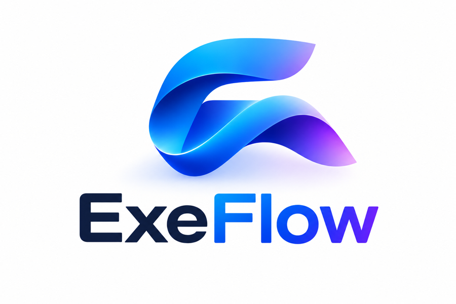

# ExeFlow

Open Windows `.exe` and `.msi` files on a Mac. Built on [Wine](https://www.winehq.org).

**Status: experimental.** Expect programs that don't work.

- Opens and inspects a file without running it, then runs it when you click.
- Offers one-click setup of .NET Framework 4.x and .NET desktop runtimes, downloaded from Microsoft after you accept the license.
- Gives each opened file its own Windows environment, inside a macOS sandbox that blocks your personal files.
- Lists real programs with their icons, not every helper `.exe`.

## Limits

- Tested on one Apple Silicon Mac. The app compiles for Intel Macs but has never run on one.
- Direct3D 10 and 11 programs, which includes most modern games, don't work. Neither do kernel drivers.
- Needs Apple Rosetta, which Apple is cutting back in macOS 28.
- The sandbox uses Apple's deprecated `sandbox-exec`. It is strong protection, not a guarantee. Only open programs you trust.
- Wine is built here from WineHQ source, but its host libraries (FreeType, GnuTLS, SDL, MoltenVK), Mono and Gecko come from a downloaded community build. Nothing is notarized.
- Media playback through GStreamer is not built.
- Moving an environment with Microsoft .NET to a newer Wine version stalls; not solved yet.

## Build

Needs Xcode 26, Rosetta, and `brew install mingw-w64 bison freetype gnutls sdl2`.
The first build compiles all of Wine and takes a while.

    scripts/bundle.sh && open dist/ExeFlow.app

## Test

    swift test
    Tests/compat/build.sh && Tests/compat/run.sh <wine folder> <scratch folder>

`run.sh` expects an initialised Wine prefix at `<scratch folder>/prefix`.

## Wine patches

| Patch | Fixes |
|---|---|
| `wow64cpu-rosetta.patch` | 32-bit crashes under Rosetta (WineHQ bug 60494) |
| `winemac-deadlock.patch` | A deadlock between window locks |
| `winemac-app-name.patch` | Shows the program's name instead of "wine" in the Dock |

## License

MIT for this project; LGPL-2.1-or-later for `patches/`. Wine and the libraries bundled with it keep their own licenses. Microsoft components are never bundled. Not affiliated with Microsoft, Apple or WineHQ.

## Contributing

Issues and pull requests are welcome. Run `swift test` first, and the compatibility suite for engine changes. Don't attach Windows programs you aren't allowed to share.
